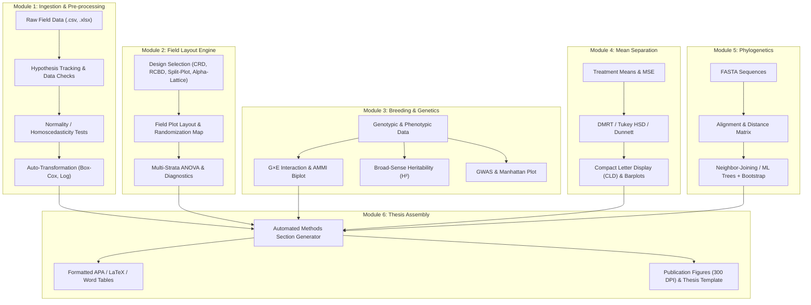

# agristat

<!-- badges: start -->
[](https://github.com/lunganlungpg/agristat/actions/workflows/R-CMD-check.yaml)
[](https://lunganlungpg.github.io/agristat/)
[](https://lifecycle.r-lib.org/articles/stages.html#stable)
[](https://www.r-project.org/)
[](https://www.gnu.org/licenses/gpl-3.0)
[](https://lunganlungpg.github.io/agristat/)
<!-- badges: end -->

> **Comprehensive Biostatistical Suite for Agricultural and Genetic Research**  
> An integrated R package providing end-to-end workflows from field experimental layout and phenotypic data ingestion, to advanced breeding analytics, phylogenetics, and automated thesis/publication reporting.

---

## 🌟 Key Highlights

- **Field Layout Engine**: Generate, randomize, and visualize standard and complex agricultural designs (CRD, RCBD, Latin Square, Factorial, Split-Plot, Split-Split Plot, Strip Plot, Augmented Block, Alpha Lattice).
- **Automated Assumption Diagnostics**: Automated Shapiro-Wilk normality, Levene/Bartlett homoscedasticity, outlier detection, and smart Box-Cox power transformations.
- **Breeding & Multi-Environment Analytics**: G×E interaction partitioning, AMMI (Additive Main Effects and Multiplicative Interaction) biplot generation, broad-sense heritability ($H^2$), and single-marker GWAS with publication-quality Manhattan and Q-Q plots.
- **Comprehensive Post-Hoc Tests**: Duncan's Multiple Range Test (DMRT), Tukey's HSD, Dunnett's test against controls, and orthogonal polynomial contrasts with automatic compact letter display (CLD).
- **Phylogenetics & Evolutionary Mapping**: FASTA sequence parsing, pairwise distance matrices, Neighbor-Joining (NJ), Maximum Likelihood (ML) tree construction with bootstrap support and unrooted tree plotting.
- **Thesis & Publication Assembly**: Auto-generated Materials & Methods text in scientific prose, APA-formatted ANOVA tables, 300 DPI publication figures, and complete thesis chapter templates.

---

## 🗺️ System Architecture



---

## 📦 Six Integrated Modules

| # | Module | Key Capabilities | Primary Functions |
|:---:|:---|:---|:---|
| **1** | **Data Ingestion & Pre-Processing** | Smart schema validation, missing data imputation, assumption checking, Box-Cox transformation, Chi-square Mendelian segregation | `import_field_data()`, `declare_hypothesis()`, `check_assumptions()`, `auto_transform()`, `chi_square_segregation()` |
| **2** | **Field Layout Engine** | Complete experimental designs, spatial field maps, randomization seeds, multi-strata error partitioning ANOVA | `design_crd()`, `design_rcbd()`, `design_latin_square()`, `design_factorial()`, `design_split_plot()`, `design_alpha_lattice()`, `analyze_design()`, `plot_field_layout()` |
| **3** | **Breeding & Genetics** | Genotype × Environment (G×E) models, AMMI biplots, variance component estimation, broad-sense heritability ($H^2$), GWAS | `fit_ammi()`, `analyze_gxe()`, `plot_ammi_biplot()`, `calc_heritability()`, `run_basic_gwas()`, `plot_manhattan()`, `plot_qq_gwas()` |
| **4** | **Mean Separation** | Duncan's Multiple Range Test (DMRT), Tukey's Honestly Significant Difference, Dunnett's control comparison, Orthogonal contrasts | `dmrt()`, `tukey_hsd()`, `dunnett_test()`, `mean_separation()`, `assign_letters()`, `plot_means()`, `plot_tukey()` |
| **5** | **Phylogenetics** | Sequence alignment, Kimura-2P/Jukes-Cantor distance matrices, NJ & ML tree inference, bootstrap consensus, tree rerooting | `read_fasta()`, `align_sequences()`, `compute_distance_matrix()`, `build_tree_nj()`, `build_tree_ml()`, `bootstrap_tree()`, `plot_phylo()` |
| **6** | **Thesis Assembly & Export** | Automated scientific prose synthesis for Methods, APA/Markdown/LaTeX tables, high-resolution figures, reproducible thesis bundle | `generate_methods_text()`, `export_results_table()`, `export_figure()`, `compile_report()`, `thesis_template_methods()` |

---

## 🚀 Installation

Install the development version from GitHub using `pak` (recommended) or `devtools`:

```r
# Option 1: Using pak (fastest)
# install.packages("pak")
pak::pak("lunganlungpg/agristat")

# Option 2: Using devtools / remotes
# install.packages("devtools")
devtools::install_github("lunganlungpg/agristat")
```

---

## ⚡ Quick Start Walkthrough

### 1. Experimental Design & Field Layout (Module 2)

```r
library(agristat)

# Generate a Randomized Complete Block Design (RCBD)
rcbd <- design_rcbd(
  treatments = c("Variety_A", "Variety_B", "Variety_C", "Check_Control"),
  blocks     = 4L,
  seed       = 101L
)

# Visualize the field trial plot map
plot_field_layout(rcbd)

# Inspect the layout table
head(rcbd$layout)
```

### 2. Statistical Analysis & Assumption Diagnostics (Modules 1 & 2)

```r
# Simulate response yield data
set.seed(42)
df <- rcbd$layout
df$yield <- rnorm(nrow(df), mean = 6.2, sd = 0.75)

# Verify ANOVA assumptions (normality, homoscedasticity)
assumptions <- check_assumptions(df$yield, group = df$treatment)
summary(assumptions)

# Perform ANOVA with correct error term stratification
aov_model <- analyze_design(rcbd, response = "yield", data = df)
summary(aov_model)
```

### 3. Post-Hoc Mean Separation (Module 4)

```r
# Compute treatment means and run Duncan's Multiple Range Test (DMRT)
means_vec <- tapply(df$yield, df$treatment, mean)
duncan_res <- dmrt(
  means = means_vec,
  mse   = 0.56,
  df    = 9,
  n     = 4,
  alpha = 0.05
)

# Print means with compact letter display (e.g., 'a', 'ab', 'b')
print(duncan_res)

# Plot publication-ready mean comparison chart with error bars & letters
plot_means(duncan_res, xlab = "Variety", ylab = "Yield (t/ha)")
```

### 4. Breeding Analytics: AMMI & Heritability (Module 3)

```r
# Multi-environment trial: GxE interaction & AMMI model
ammi_fit <- fit_ammi(
  data        = multi_env_data,
  genotype    = "Genotype",
  environment = "Environment",
  rep         = "Rep",
  yield       = "Yield"
)

# Generate publication-grade AMMI1 / AMMI2 biplots
plot_ammi_biplot(ammi_fit, biplot_type = "AMMI1")

# Estimate broad-sense heritability (H²)
h2 <- calc_heritability(
  var_g   = 1.84,
  var_ge  = 0.42,
  var_e   = 0.35,
  n_env   = 3,
  n_rep   = 4
)
cat("Broad-sense Heritability (H²):", round(h2$H2, 3), "\n")
```

### 5. Automated Thesis & Report Generation (Module 6)

```r
# Automatically write the statistical methodology in academic prose
methods_doc <- generate_methods_text(rcbd, aov_model, duncan_res)
cat(methods_doc$text)

# Export publication-ready tables in LaTeX or Markdown
export_results_table(aov_model, format = "markdown")

# Compile full report with figures, ANOVA, and post-hoc comparisons
compile_report(
  title  = "Yield Evaluation Across Agronomic Cultivars",
  author = "Lung An",
  output_format = "pdf"
)
```

---

## 📚 In-Depth Vignettes

Explore the step-by-step guides for each research domain:

1. [**01: Data Ingestion & Pre-Processing**](vignettes/01-data-ingestion.Rmd) — Hypothesis tracking, missing values, and Box-Cox transformations.
2. [**02: Field Designs**](vignettes/02-field-designs.Rmd) — In-depth tutorial covering CRD, RCBD, Split-Plot, Strip-Plot, and Alpha-Lattice designs.
3. [**03: Genetics & GWAS**](vignettes/03-genetics-gwas.Rmd) — Multi-environment G×E modeling, AMMI biplots, heritability, and GWAS Manhattan plots.
4. [**04: Mean Separation**](vignettes/04-mean-separation.Rmd) — Detailed comparison of DMRT, Tukey's HSD, Dunnett's test, and orthogonal contrasts.
5. [**05: Phylogenetics**](vignettes/05-phylogenetics.Rmd) — DNA/protein sequence alignment, Neighbor-Joining, and Maximum Likelihood trees.
6. [**06: Thesis Assembly & Export**](vignettes/06-thesis-export.Rmd) — Exporting APA/LaTeX tables, high-DPI figures, and compiling complete research theses.

---

## 🛠️ Requirements & Dependencies

- **R**: `>= 4.1.0`
- **Core Dependencies**: `ggplot2`, `dplyr`, `tidyr`, `readr`, `sf`, `car`, `agricolae`, `lme4`, `nlme`, `multcomp`, `ape`, `phangorn`, `survival`
- **Optional / Suggested**: `testthat`, `knitr`, `rmarkdown`, `pkgdown`, `ggtree`, `officer`, `flextable`

---

## 📖 Citation

If you use `agristat` in your agricultural research, field trials, or graduate thesis, please cite:

```bibtex
@manual{agristat2026,
  title  = {agristat: Comprehensive Biostatistical Suite for Agricultural and Genetic Research},
  author = {Lung An and Lung Pg},
  year   = {2026},
  note   = {R package version 1.0.0},
  url    = {https://github.com/lunganlungpg/agristat}
}
```

---

## 📄 License

This project is licensed under the **GNU General Public License v3.0 (GPL-3.0)** — see the [LICENSE](LICENSE) file for details.
